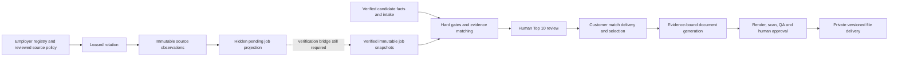

# ApplyPack master implementation pass — September 20, 2026

Status: **NOT READY**. This is an engineering candidate published for review, not a production launch or activation. The latest master directive governs the complete discovery-to-delivery chain. Earlier document-only scope is superseded. Source, build, database, rendering, hosted service and customer delivery evidence remain separate.

## A. Architecture before

Canonical checkout: `C:\Users\mskir\Desktop\Apply_Pack\applypack-production-v2`; origin `https://github.com/duotapmobile/ApplyPack.git`; branch `codex/employer-first-aggregation-2026-09-15`; base commit `f7081ecc64e79d262c1d0385c238f27323c86f6b`. The checkout already contained substantial uncommitted employer-source work. It was retained and hardened.

Next.js 16.3.4/React 19.2.8/TypeScript provide the web and API application. Supabase PostgreSQL holds candidate facts, immutable intake/job snapshots, requirement nodes, matching evaluations, reviews, commerce, artifact lineage, audit records and leased jobs. Stripe supplies verified payment events; private storage, scanning, document rendering and protected payload services are separate dependencies. Railway runs web and maintenance services.

Existing strengths: structured intake and matching, evidence provenance, exact-ten release checks, private material manifests, server entitlements, deterministic filenames, source policy records, five structured ATS adapters and a leased employer rotation foundation. The newer canonical document path coexisted with a weaker legacy generator/upload path. Rotation collected immutable observations but did not feed verified customer inventory.

The neutral paid search board and curated Top 10 remain separate products under the recovered September 9 amendment. Inventory presence is not a human endorsement.

## B. Problems found

- Legacy generation and raw-upload delivery could bypass the stronger material-line workflow.
- Citing a real fact UUID did not prove the wording of a claim. Narrative text could carry unsupported claims; negative credential words could match positive substrings.
- A later fact correction or explicit job successor did not consistently invalidate already released files.
- Board admission needed fresh, actionable verification at both computation and read boundaries; checkout still pinned the older admission version.
- Source observations were disconnected from canonical jobs. Projection needed to preserve restrictions, reject conflicting identities and never manufacture verification.
- Migration 037 had SQL syntax defects that source-string tests did not catch: a reserved alias and repeated `FUNCTION` keywords in privilege lists.
- Supabase CI exposed default service-role write privileges on new source authority/evidence tables that the initial native bootstrap did not model. Explicit revocation before narrow regrants fixes the unfenced-write path; the SQL regression and native bootstrap now exercise these defaults.
- Operations code was behind the integration branch, counted legacy scheduling flags and could report missing source data as empty results. Structural file validation could be mistaken for live malware readiness.
- GitHub, the local checkout, staging and production were different revisions. Hosted readiness is failing; source schedules and real inventory are absent.

## C. Changes implemented

| Area | Files and behavior |
| --- | --- |
| Source foundation | Existing adapter/rotation work retained; `source-projection.ts` and migration `202609200039_pending_source_projection.sql` add immutable, idempotent projection records and hidden jobs. Projection retains factual restrictions, rejects conflicting job identities and preserves functional URL parameters. It does not create verification evidence. |
| Original source records | `jobs/raw-source-evidence.ts`, the five ATS adapters and `source-collection.ts` preserve accepted original provider JSON records/full RSS items, adapter versions and deterministic hashes. Missing/tampered/version-mismatched evidence cannot form an authoritative complete ledger. This preserves parsed records, not exact HTTP response bytes. |
| Migration repair | `202609150037_employer_first_job_aggregation.sql`: fixed PostgreSQL alias and privilege-list syntax. Source activation defaults remain disabled. |
| Supabase default grants | Migrations 037/039 explicitly remove inherited service-role table writes before granting the intended read-only or append-only access. Authority and projection mutations use validated RPCs. Runtime callers were independently checked for compatibility; SQL fixtures cover INSERT/UPDATE/DELETE/TRUNCATE permissions. |
| Truth validation | `documents/claim-validation.ts`, admin material generation route, `matching/credential-state.ts`: exact verified wording, bound employment/education/career-break records, conservative capability handling, no fact-ID/narrative laundering or positive credential substring matching. Experience bullets/descriptors must belong to that employment record or explicitly link to it through verified `employmentFactId`. |
| Canonical materials | Removed `generateApplyPackDrafts`; workflow redirects legacy document tasks to evidence binding. Legacy raw delivery/correction routes reject new writes through `materials/legacy-boundary.ts`. History is preserved. |
| Stale delivery | Migration `202609200038_material_fact_invalidation.sql` invalidates files/reviews after candidate fact changes. Migration `202609200040_board_contact_and_current_download.sql` adds transactional current-fact/job checks, explicit successor and linked-job closure/inactivation invalidation, backfill and protected board-contact facts. Approval/release/new download authorization reuse the guards. Already-issued storage URLs retain their bounded 15-minute lifetime. |
| Board and orders | `job-board/recompute.ts`, three board API routes and migration 040 enforce admission v3, fresh successful verification and open application paths. `workflow/process.ts` preserves human decisions on retry, makes shortage escalation explicit and checks persistence errors. |
| Operations | Restored current health/maintenance safeguards and aggregate admin summary from the integration branch. Summary now reads actual schedules and revisioned source authority. Missing schema/data is unhealthy. Source admin GET returns 503 on query failure. |
| Rendering | Canonical DOCX language/heading structure and PDF catalog language validation corrected; temporary-file cleanup retries bounded. `scripts/test-document-render-windows.ps1` pins installed local tools for actual rendering. |
| Validation tooling | `scripts/test-database-native.ps1` supplies an isolated PostgreSQL fallback with explicitly limited Supabase-compatible schemas; normal Docker database tests remain required for provider parity. `vitest.config.mts` caps concurrent DOM test runtimes after unconstrained workers caused dynamic-import timeouts; assertions remain unchanged. |

All paths above are relative to `src/lib/`, `src/app/api/`, or `supabase/migrations/` as appropriate. The code-only candidate was committed and pushed to the existing local feature branch, with draft PR [#3](https://github.com/duotapmobile/ApplyPack/pull/3), current head `8f03cd4309d9bb98cb79fade499f0f4870ec4084`. The candidate changes 74 code/configuration/test files from the original local HEAD; private documentation, research and evidence remain local and unstaged. No package framework replacement, production source activation, payment activation, merge or deployment was performed.

## D. Search and sourcing status

Fresh local registry calculation: **79 sources, 75 distinct employer IDs, 76 active flags, 0 scheduled flags**. Adapter configurations: Greenhouse 6, Lever 2, Ashby 1, official-link-only 67, existing-import 3. Implemented structured adapters: Greenhouse, Lever, Ashby, Recruitee and Teamtailor. No configured Recruitee/Teamtailor tenant is activated. Workday/Workable/SmartRecruiters automation remains unimplemented; official pages remain manual where applicable.

Staging API rechecked September 20 at 22:59 UTC: **80 source records, 76 distinct employer IDs, 79 active flags**. Configurations: Greenhouse 6, Lever 2, Ashby 1, official-link-only 67, existing-import 4. Automation labels: automated 7, existing-import 3, official-link-only 65, pending-verification 5. These labels are not proof of current automation authorization.

Staging operational queries at 22:46 UTC: **0 scheduled legacy flags, 0 real source runs, 0 real active/open jobs**. The new `job_source_schedules` endpoint returns 404. Source worker remains disabled. Real ingestion tests and real jobs ingested in this pass: **0**. Fixture adapters test complete, partial, failed and malformed responses without activating employer traffic. No current live provider failure rate can be calculated from zero runs.

## E. Matching status

Existing matching retains hard PASS/FAIL/UNKNOWN rules, verified candidate evidence, transferable relationships and separate coverage dimensions. Confirmed hard failures cannot be rescued by ranking. This pass fixes credential polarity, preserves human decisions during replay and records shortage/manual-research escalation without padding.

Still incomplete: automatic promotion from collected observations to verified immutable snapshots, customer-specific extraction/evaluation orchestration, staged expansion, and a demonstrated real full fulfillment cycle. The current pending projection deliberately cannot satisfy these gates. The canonical candidate truth layer is shared by matching and the material generation route; unsupported draft paraphrases remain rejected.

## F. Document status

One supported customer-generation route now uses immutable material-line bindings. DOCX/PDF rendering is locally demonstrated with installed LibreOffice/Poppler, Arial pins, selectable text, page/structure/metadata checks and visual inspection. Natural names and unbolded cover signatures are tested. Existing centralized customer filenames and candidate-specific page rules are preserved.

Truth checking is conservative and extractive: a new paraphrase needs separately verified candidate wording. This pass does not implement an unrestricted semantic claim verifier or an autonomous drafting/humanization service. No later humanization step may bypass validation. Actual provider scanning, protected payload decryption, hosted storage and approved customer download still need an end-to-end deployment test. A structural pass is not a malware-scan pass.

## G. Test results

Final command results are recorded below. The native database harness uses real PostgreSQL with synthetic auth/storage compatibility objects; it is not Supabase Auth, PostgREST or Storage proof. Fixture HTTP and payment paths do not establish live provider behavior.

| Command | Result |
| --- | --- |
| `npm.cmd run check` | Passed: lint, typecheck, 64 files / 467 unit tests, production build with 58 static pages |
| `npx.cmd vitest run tests/unit/document-generator.test.ts --maxWorkers=1` | 23 tests passed, including the final unfinished-degree regression added after the combined suite loaded that file; final production build includes the guard |
| GitHub CI `npm run lint`, `npm run typecheck`, `npm test`, `npm run build` | Passed on final head `8f03cd4309d9bb98cb79fade499f0f4870ec4084`: 64 files / 468 tests and production build |
| `npx vitest run tests/unit/document-generator.test.ts tests/unit/raw-source-evidence.test.ts tests/unit/source-adapters.test.ts tests/unit/source-projection.test.ts tests/unit/source-operations-route.test.ts --maxWorkers=2` | 5 files / 53 tests passed after those additions |
| `npm run test:integration` | 1 structural-quarantine test passed; 2 real ClamAV tests skipped because live scanner integration is not configured |
| `powershell.exe -NoProfile -File scripts/test-document-render-windows.ps1` | Real render suite passed: 3 scenarios, 7 artifacts, 8 pages; optional package-only case skipped. Evidence: `evidence/applypack-chunk5-render-20260920-184105/render-report.json` |
| `npm run test:database` | Docker timed out after 60 seconds; no Supabase database pass claimed |
| GitHub CI Supabase start/reset, `npm run test:database`, checkout concurrency, RLS/financial and intake/delivery fixtures, preserved-data migration | Passed on final head using Supabase PostgreSQL image `17.6.1.167`: all 46 migrations, seven corrected-contract suites, three additional invariant suites and historical migration assertions. Isolated CI proof; no hosted staging/production migration performed |
| `powershell.exe -NoProfile -File scripts/test-database-native.ps1 -RetainClusterData` | 46 migrations / 7 SQL fixture suites passed on PostgreSQL 18.6, including final closure/download guards; input hashes match current files |
| `powershell.exe -NoProfile -File scripts/test-database-native.ps1 -LegacyBackfill -RetainClusterData` | Current 46 migrations + legacy seed/verify passed (`LEGACY_BACKFILL_OK`); input hashes match current files |
| `npx playwright test tests/e2e/chunk4-evidence.spec.ts tests/e2e/chunk5-evidence.spec.ts --project=desktop --workers=1` | 4 passed in 8.8 minutes, including viewport, keyboard, reduced-motion and zoom checks; customer/operator UI fixtures, not hosted fulfillment proof |
| GitHub CI `npm run test:e2e` | 106 passed, 6 intentional platform-specific skips in 5.0 minutes on final head; fixture browser flows, not hosted customer/provider proof |

Latest native database proof after the Supabase grant correction: `evidence/native-db-grants-fixed-2026-09-20/`, with 46 migrations / 7 fixtures and matching input hashes under the stronger default-grant bootstrap. Final legacy proof: `evidence/native-db-grants-legacy-2026-09-20/`, with 46 migrations / 2 fixtures, `LEGACY_BACKFILL_OK` and matching hashes. Earlier evidence remains in `evidence/native-db-2026-09-20/`. The PowerShell harness now retains the process handle so a missing exit code cannot be mistaken for success. All completed test clusters were stopped. Optional historical temporary-cluster cleanup was rejected by automatic approval review as “blocked by policy”; stopped data remains. The script's cleanup branch is untested; validated runs explicitly retain cluster data.

## H. Deployment status

GitHub `main` remains `aa60adf85d0a1ae7c42769ac4171e2ff8eea18e8` (fresh read this pass). Production Railway reports that older revision. Staging remains the September 12 upload; no current local changes are deployed.

Draft PR [#3](https://github.com/duotapmobile/ApplyPack/pull/3) publishes the code-only candidate at `8f03cd4309d9bb98cb79fade499f0f4870ec4084`. The first CI run exposed the default-grant defect described above. The corrected-candidate [CI run](https://github.com/duotapmobile/ApplyPack/actions/runs/35545355114) passed all three jobs: verify, database and browser. Final browser result: 106 passed / 6 intentional skips. The feature branch is connected to its remote; this does not change `main` or either hosted environment.

Fresh staging `/api/live`: **200**. Staging `/api/health`: **503**. `https://applypack.work/api/live` could not be reached from this environment. Payment mode is disabled, checkout false, source worker false. The previously authorized maintenance pause remains in place; its historical crash status does not mean a new crash occurred during this pass.

The next deployment verification must use one exact candidate SHA:

1. Require successful verify/browser/database CI for the PR head, including fresh migration, tenant/payment invariants and preserved-data migration. Review the code-only diff before any merge.
2. Confirm the selected Railway service and database belong to staging, preserve payment/source/projection disable flags, record the migration ledger and backup, then apply the reviewed forward migrations to that identified staging database. Never use a production reset command.
3. Deploy the exact reviewed code to staging. Confirm build/start logs, actual deployed revision, `GET /api/live`, dependency details from `GET /api/health`, and the authenticated MFA-protected `GET /api/admin/operations/summary`. Restart the web process and repeat these checks.
4. After separately approving the relevant environment/source activation, invoke `POST /api/cron/maintenance` and the dedicated `POST /api/cron/job-sources` using the configured bearer secret without printing it. Verify one successful heartbeat, lease/retry behavior and immutable complete/partial run evidence. Do not claim customer supply until the unfinished verification bridge is implemented.
5. With two synthetic customers, run verified intake, Stripe test-mode purchase/webhook replay, exact-ten match approval, customer selection, document purchase, canonical generation, actual scan/render validation, human approval and authenticated downloads. Repeat each private request under the other customer and require denial; correct a fact/close the job and require stale release/download denial.
6. Confirm the final host's DNS/TLS, mail delivery and runtime readiness before preparing a separate production activation. Preserve evidence for the exact revision and actual provider results; fixture success cannot substitute for this sequence.

## I. Remaining launch blockers and exact next actions

| Blocker | Prepared | Next action | Prevents launch? |
| --- | --- | --- | --- |
| Verified sourcing-to-matching bridge is unfinished | Immutable observations, fenced rotation, hidden canonical projection, existing snapshot/matching services | Finish verified snapshot promotion and customer evaluation orchestration; run an authorized real canary and cadence tests | Yes for automated sourcing/fulfillment |
| Hosted staging migration and provider behavior unproven | Current candidate passes isolated Supabase 17 fresh and preserved-data migration plus native PostgreSQL fixtures | Apply the reviewed migration chain to the identified staging environment and verify Auth/Storage/PostgREST and runtime behavior with synthetic customers | Yes |
| Documents not proven through hosted services | Canonical guard, real local renderer proof, stale checks | Configure/verify actual scanner, renderer and protected payload services; generate, approve and download a synthetic packet in staging | Yes for paid materials |
| Payment/entitlement provider activation intentionally off | Server-priced checkout, webhook and entitlement code/fixtures | Validate Stripe test-mode events/replay/capacity with the exact release, then separately approve live activation | Yes for paid launch |
| Deployment/version/domain mismatch | Code-only candidate published as draft PR #3 with all three CI jobs green; migrations and verification procedures prepared | Deploy/migrate the reviewed candidate to staging, verify health/workers and the full synthetic customer journey, then separately approve production and domain activation | Yes |

These include unfinished implementation as well as external verification; code gaps are not attributed to missing credentials. No authorized production traffic or spending is inferred from passing tests.

## J. Launch verdict by subsystem

| Subsystem | Verdict | Missing proof or implementation |
| --- | --- | --- |
| Sourcing | PARTIAL | Verified projection, authorized active schedules, real ingestion/cadence proof |
| Matching | PARTIAL | Complete ingestion-to-customer orchestration and representative end-to-end evaluation |
| Documents | PARTIAL | Usable verified draft authoring and hosted scan/render/approval/download proof |
| Payments/Entitlements | BLOCKED | Disabled provider activation and current release payment tests |
| Admin Review | PARTIAL | Complete connected order/material workflow through hosted data |
| Security | PARTIAL | Isolated Supabase checks pass; hosted provider isolation and current deployment verification remain |
| Deployment | BLOCKED | Current code/migrations undeployed; readiness/domain failing |

Overall: **NOT READY**. No subsystem is marked ready merely because local tests pass.
