# Soft-opening requirement matrix — September 22, 2026

**Private evidence; not for Git publication. Overall: NOT READY.** This is the 95-section requirement matrix, not the final A–J release report. Root owns the final deployment/activation decision.

Canonical checkout: `C:/Users/mskir/Desktop/Apply_Pack/applypack-production-v2`; origin `https://github.com/duotapmobile/ApplyPack.git`; branch `codex/employer-first-aggregation-2026-09-15`. Review baseline: `10709637cd81f5b7c83338c5b22691f86b408693`. Current desktop/GitHub/deployed production and staging source: 9cf14454425ff9b4b924c9ad6aeb9010f5ebcb31. PR 4 merged; all eight main CI 35704228424 jobs passed. Checkout remains disabled; customer launch is NOT READY. Paths are repository-relative; private receipts must remain private.

## Current architecture

```mermaid
flowchart LR
  Policy[Employer registry and current permission] --> Collect[Bounded adapters or reviewed manual observation]
  Collect --> Raw[Immutable raw records and hidden canonical jobs]
  Raw --> Verify[Official direct verification and immutable snapshot]
  Intake[Private intake and isolated extraction] --> Truth[Typed facts, customer confirmation and immutable criteria]
  Verify --> Match[Current-source admission and evidence hard gates]
  Truth --> Match
  Match --> Board[Neutral board with subscription entitlement]
  Match --> Feasibility[Coverage and feasibility before purchasing]
  Feasibility --> Order[Verified payment and capacity-controlled fulfillment]
  Order --> Review[Research, clarification and exact-ten human review]
  Match --> Review
  Review --> Delivered[Approved match delivery]
  Delivered --> Select[Customer materials selection]
  Board --> Select
  Select --> Docs[Evidence-bound rendering and human approval]
  Docs --> Delivery[Versioned private delivery with current authorization]
  Providers[Supabase Auth/DB/Storage, AWS KMS, Stripe, email and Railway workers] -. dependencies .-> Order
  Providers -. dependencies .-> Delivery
```

Collection is independent of a customer search. Manual checklists do not prove exhaustive automated collection or authorize absence-based closure. `0`, `9` or `11` selected jobs cannot satisfy an exact-ten release; local synthetic commerce fixtures exercise cardinality and authorization, not a paid customer journey.

## Current evidence and limits

| Scope | Observed evidence | Boundary |
|---|---|---|
| Unit and native integration | Final CI:84 unit files / 587 tests passed; all five browser projects passed (271 tests, 24 intentional skips, no retries); production build passed. Latest inspected `evidence/soft-opening/native-final-051-2/RESULT.txt`: 56 migrations + 9 fixtures PASS. `native-combined-20260922-9/capacity-pressure-result.json`: ten independent capacity rounds, replay and denial proof. | Native PostgreSQL uses synthetic Auth/Storage compatibility; these are not hosted service transactions or a substitute for the complete hosted journey. |
| Hosted schema | `evidence/soft-opening/staging-migration-receipts.json`, `production-migration-receipts.json`, `staging-migration-051.json`, `production-migration-051.json`. | Applied schema is distinct from application deployment and operational readiness. |
| Hosted public pages at `80e1f76428976c47dfec40ebba1bcd52f7b42964` | Root execution-console result: `npm run test:hosted -- --workers=1 --retries=0` with ephemeral anonymous state, 8/8 passed in 14.4m across 18 routes and four engines. | Public scope only. Earlier HTML/traces were overwritten; do not claim they remain retained. |
| Hosted public controls at `baa8870f7b29d9a2db8b8e65216802e290772a5a` | `npm run test:hosted -- public-controls.spec.ts --workers=1 --retries=0`: 12/12 passed in 2.8m; `evidence/soft-opening/browser-report/` and `browser-artifacts/` support this latest run. | Navigation, tabs and homepage controls; not every customer/admin control, physical device, assistive technology or protected journey. |
| Local WebKit regressions | Focused desktop/mobile WebKit controls + axe: 8/8 passed without retries. Latest mobile WebKit homepage axe + comparison scrolling: 2/2 passed without retries. Tests: `tests/e2e/public-controls.spec.ts`, `public.spec.ts`, `why-customize.spec.ts`. | React hydration is awaited. Mobile WebKit scrolling uses real keyboard PageDown; it is not physical touch proof. Final all-project CI and merged-main CI passed. A traced smooth-scroll race was fixed in intake-brief.css;five repeated checkbox and two keyboard/review checks passed without retries. |
| Real authentication and upload | Private receipts: `evidence/soft-opening/private/auth-result.json`, `authenticated-portal.png`, `upload-smoke-1790059943441.json`, `upload-smoke-1790060007312.json`, `upload-admin-readback.json`, `upload-private-readback.json`. | Real OTP/session; eight valid PDF/DOCX uploads accepted QUARANTINED into private Storage; four malformed uploads returned 400, then rate limiting returned 429. All eight later became SUPERSEDED/soft-deleted, with zero active/current records; physical object deletion is not claimed. Three public object reads returned 400 and three anonymous admin-source requests returned 401; this is not authenticated cross-customer proof. Extraction/confirmation did not pass: Railway bwrap namespace probe fails and KMS is missing. No CLEAN or parsed result is claimed. |
| Final merged hosted public/intake | node Playwright CLI against staging 9cf1445: 2/2 passed across 18 routes, zero retries or skips; evidence/soft-opening/hosted-final-public.json and route-action-inventory-final.json | Public inventory/intake errors only, not complete protected/admin actions. |
| Hosted bounded pressure at `80e1f76` | `evidence/soft-opening/hosted-pressure/result.json`: ten contexts, three own drafts, 2,322 requests at 4 requests/second over 600.5s, zero unexpected outcomes, p95 587ms. | Expected throttles are bounded refusal evidence. Queue growth and paid fulfillment were not tested. |
| Real document rendering | `evidence/soft-opening/ci-linux-render/render-report.json` and `ci-document-render.log`: seven Linux artifacts / eight pages passed; synthetic truth in `fixtures/truth-and-expectations.json`. | Real rendering is proven in this fixture scope; hosted evidence-to-review-to-authorized-download remains unproved. |

Statuses: `VERIFIED_LOCAL` means the row's bounded criterion has observed local test evidence; it never means hosted or complete section coverage. `PARTIAL` includes implemented connections and incomplete acceptance scope. `BLOCKED` means required integrated/provider proof is missing. `NOT_APPLICABLE` is reserved for process-only rules or a currently unused mechanism. Owners are functional responsibilities; Root coordinates release, Sources collection, Product matching/intake, Security document/privacy and Ops runtime dependencies.

Accepted exceptions are narrow: **scanner v2 is deferred**, with `PENDING` / `NOT_SCANNED` preserved rather than fabricated CLEAN/model-ready results; structural extraction and document validation remain required. **Liberation Sans is accepted**, with actual font/renderer evidence, not relabeled historical Arial approvals. Existing AWS was selected, but selection alone does not prove KMS/deployed protected workflows.

Source policy is scoped: an empty internal permission record is not itself an external legal prohibition. [VIPdesk](https://vipdesk.com/) links [VIPdeskjobs](https://vipdeskjobs.com/); its [current-openings page](https://vipdeskjobs.com/current-openings/) identifies Lever tenant `vipdesk`. [Lever's primary API documentation](https://github.com/lever/postings-api) documents public postings retrieval, supporting the authorized bounded private pilot review. This does **not** prove paid-display rights or authorize schedules/customer visibility/absence closure. Current source counts and activation receipts belong in Root's final report.

## 95 requirements

| # / requirement | Owner | Concrete acceptance criterion | Current code / test evidence | Status |
|---|---|---|---|---|
| 1 Product contract | Product / Root | Preserve board subscription, $20 exact-ten search and $8 selected-job materials, without guarantees. | `docs/applypack/11_SEPTEMBER_9_FINAL_PRODUCT_AMENDMENT.md`; `tests/unit/copy-authority.test.ts` | PARTIAL |
| 2 Operating principles | All | Fail closed on unknown evidence; preserve provenance, permissions and customer choice. | `AGENTS.md`; `src/lib/matching/evidence-derived.ts` | PARTIAL |
| 3 First action audit | Root | Establish canonical identity, dirty state, governing authority and deployment differences before changes. | `AGENTS.md`; `docs/evidence/WORKSPACE_GITHUB_LAUNCH_AUDIT_2026-09-20.md` | PARTIAL |
| 4 Do not stop minor decisions | All | Resolve reversible implementation details within existing authority; this is a work-process rule. | `AGENTS.md`; this matrix's scope | NOT_APPLICABLE |
| 5 End to end architecture | Root | Prove connected discovery-to-private-delivery with real dependencies, not isolated APIs. | `src/lib/workflow/process.ts`; `tests/hosted/public-actions.spec.ts` | BLOCKED |
| 6 Decouple collection/search | Sources / Product | Independent verified inventory must admit into customer-specific plans without changing source truth. | `src/lib/jobs/verified-source-inventory.ts`; `supabase/migrations/202609220045_matching_fulfillment_completion.sql` | PARTIAL |
| 7 Source registry | Sources | Every active source has canonical employer identity, endpoint and accountable policy. | `src/lib/jobs/source-registry.ts`; `tests/unit/source-registry.test.ts` | PARTIAL |
| 8 Permission aware policy | Sources / Owner | Current authority and allowed use govern access; public availability does not authorize paid redistribution. | `supabase/migrations/202609150037_employer_first_job_aggregation.sql`; `tests/unit/coverage-authority.test.ts` | PARTIAL |
| 9 ATS adapter layer | Sources | Supported adapters preserve identity and distinguish complete, bounded and failed reads. | `src/lib/jobs/adapters/index.ts`; `tests/unit/source-adapters.test.ts` | PARTIAL |
| 10 Employer first sourcing | Sources | Resolve real employer/official ATS identity before admitting listings. | `src/lib/jobs/source-registry.ts`; `tests/unit/verified-source-inventory.test.ts` | PARTIAL |
| 11 Employer rotation | Sources / Ops | Leased schedules honor bounds, cursors, retries, quotas and fairness without unauthorized activation. | `src/lib/jobs/source-worker.ts`; `tests/unit/source-worker.test.ts` | PARTIAL |
| 12 Immutable raw records | Sources | Preserve original provider record or manual transcription, version and hash; reject tampering. | `src/lib/jobs/raw-source-evidence.ts`; `tests/unit/raw-source-evidence.test.ts` | PARTIAL |
| 13 Field provenance | Sources | Material normalized fields retain source/method/evidence and unknowns remain explicit. | `src/lib/jobs/field-evidence.ts`; `tests/unit/source-pipeline-completion.test.ts` | PARTIAL |
| 14 Canonical jobs | Sources | Hidden pending rows cannot become visible verified inventory without current official evidence. | `src/lib/jobs/source-projection.ts`; `tests/unit/source-projection.test.ts` | PARTIAL |
| 15 Deduplication | Sources / Product | Canonical identity deduplicates postings without merging conflicting identities or padding inventory. | `src/lib/jobs/normalize.ts`; `tests/unit/chunk3-dedup-feasibility.test.ts` | PARTIAL |
| 16 Reposts/reopenings | Sources | Explicit reviewed change/reopening creates fresh lineage; stale or reverted content cannot revive invalid evidence. | `supabase/migrations/202609220044_source_pipeline_completion.sql`; `tests/integration/employer-first-aggregation.sql` | PARTIAL |
| 17 Safe job closure | Sources | Only authoritative complete runs may close missing listings; bounded/resumed/failed reads never do. | `src/lib/jobs/source-collection.ts`; `tests/integration/employer-first-aggregation.sql` | PARTIAL |
| 18 Freshness | Sources / Product | Reject stale/future direct verification and stale policy receipts before deriving feasibility. | `src/lib/matching/coverage-authority.ts`; `tests/unit/supabase-feasibility-authority.test.ts` | VERIFIED_LOCAL |
| 19 Direct links | Sources | Employer identity, active listing and actionable official application URL must match captured evidence. | `src/lib/jobs/verified-source-inventory.ts`; `tests/unit/verified-source-inventory.test.ts` | PARTIAL |
| 20 Untrusted job content | Security / Sources | Listing text is data; it cannot supply tool instructions or unverifiable candidate claims. | `src/lib/matching/listing-parser.ts`; `src/lib/documents/claim-validation.ts` | PARTIAL |
| 21 Intake model | Product | Four steps persist preferences, capabilities, compensation policies and explicit fact confirmation. | `src/app/get-started/wizard-v3.tsx`; `tests/integration/matching-fulfillment.sql` | PARTIAL |
| 22 Hard gates | Product | Missing required evidence stays unresolved and cannot be replaced by keyword fit or a score. | `src/lib/matching/evidence-derived.ts`; `tests/unit/matching-fulfillment.test.ts` | VERIFIED_LOCAL |
| 23 Required/preferred | Product | Required criteria control eligibility; preferences cannot waive them. | `src/lib/matching/requirements.ts`; `tests/unit/chunk3-requirements.test.ts` | PARTIAL |
| 24 Requirement extraction | Product | Preserve cited criteria, AND/OR structure, certainty and stable IDs; corrections supersede explicitly. | `src/lib/matching/listing-parser.ts`; `tests/unit/chunk3-review.test.ts` | PARTIAL |
| 25 Candidate truth | Product / Security | Unconfirmed extraction cannot qualify a candidate; typed annotations retain source lines and require confirmation. | `src/lib/intake/source-annotation.ts`; `tests/unit/source-annotation.test.ts`; `tests/integration/matching-fulfillment.sql` | PARTIAL |
| 26 Transferability | Product | Adjacent equivalence requires specific task, complexity, autonomy, scope and duration evidence. | `src/lib/matching/review.ts`; `tests/unit/chunk3-review.test.ts` | PARTIAL |
| 27 Match classification | Product | Distinguish direct, transferable, gap and unknown evidence; no unsupported passing classification. | `src/lib/matching/evidence-derived.ts`; `tests/unit/chunk3-persisted-evidence.test.ts` | VERIFIED_LOCAL |
| 28 No opaque fit score | Product | Explain eligibility and evidence; numeric fit cannot override gates or manufacture qualification. | `src/lib/matching/evaluation-engine.ts`; `tests/unit/chunk3-evaluation.test.ts` | PARTIAL |
| 29 Prioritization | Product | Rank only eligible useful curated candidates with deterministic explanations and bounded diversity. | `src/lib/matching/persisted-runtime.ts`; `tests/unit/chunk3-remediation.test.ts` | PARTIAL |
| 30 Adjacent discovery | Product | Retrieval starts with confirmed responsibilities and preserves hard restrictions. | `src/lib/matching/research.ts`; `tests/unit/matching-fulfillment.test.ts` | VERIFIED_LOCAL |
| 31 Expansion | Product | Maximum three operator-triggered rounds, bounded by selected breadth; no inferred qualification or padding. | `src/lib/matching/research.ts`; `supabase/migrations/202609220045_matching_fulfillment_completion.sql` | PARTIAL |
| 32 Order orchestration | Product / Commerce | Incomplete coverage, shortage and clarification remain explicit; activation and release require all contractual gates. | `src/lib/workflow/process.ts`; `tests/integration/chunk4-commerce-release.sql` | PARTIAL |
| 33 Human review packet | Product | Operator sees current criteria, source nodes, confirmed facts, decisions and unresolved questions before approval. | `src/components/admin/matching-workbench.tsx`; `src/app/api/admin/matching-research/route.ts` | PARTIAL |
| 34 Customer match presentation | Product | Present exact job, why it fits, evidence connection, unknowns, application link and customer selection. | `src/lib/materials/portal.ts`; `src/components/portal/apply-pack-selector-v2.tsx` | PARTIAL |
| 35 Exclusions | Product / Sources | Preserve hard exclusions through retrieval, evaluation and publication. | `src/lib/matching/research.ts`; `tests/unit/matching-fulfillment.test.ts` | VERIFIED_LOCAL |
| 36 Board versus curated | Product | Board stays neutral and entitlement-filtered; curated exact-ten service retains human review. | `src/lib/job-board/recompute.ts`; `tests/unit/board-recompute.test.ts` | PARTIAL |
| 37 Customer board | Product | Current profile and verified-source evidence gate board admission; neutral ordering remains intact. | `src/lib/job-board/access.ts`; `src/lib/job-board/recompute.ts` | PARTIAL |
| 38 Server entitlements | Commerce | Server validates subscription access, prices, material quantities and selected-job ownership. | `src/lib/job-board/entitlements.ts`; `tests/integration/chunk6-final-integration.sql` | PARTIAL |
| 39 Customer isolation | Security / Product | Verified session owns clarification; wrong owner and stale criteria fail, with private errors. | `src/app/api/customer/candidate-questions/route.ts`; `tests/unit/candidate-questions-route.test.ts` | VERIFIED_LOCAL |
| 40 Canonical generation | Security | Only evidence-bound material revisions reach canonical generation; legacy bypasses reject writes. | `src/lib/documents/draft-preparation.ts`; `src/lib/materials/legacy-boundary.ts` | PARTIAL |
| 41 Document rules | Security | Resume content/layout and DOCX/PDF outputs satisfy accepted rules using actual Liberation Sans evidence. | `src/lib/documents/requirements.ts`; `tests/unit/document-requirements.test.ts` | PARTIAL |
| 42 Cover letters | Security | Factual distinct supporting passages meet length/content rules without invented achievements or filler. | `src/lib/documents/draft-preparation.ts`; `tests/unit/material-draft-preparation.test.ts` | PARTIAL |
| 43 Cross-system consistency | Product / Security | Same snapshot, fact versions, review decisions and job evidence bind intake, matching and documents. | `src/lib/documents/draft-preparation.ts`; `supabase/migrations/202609220045_matching_fulfillment_completion.sql` | PARTIAL |
| 44 Claim provenance | Security | Every generated factual statement cites current verified facts; unrelated IDs cannot launder wording. | `src/lib/documents/claim-validation.ts`; `tests/unit/material-draft-preparation.test.ts` | PARTIAL |
| 45 Actual rendering | Security / Ops | Real renderer produces inspected DOCX/PDF with correct font hash, pages and text; no simulated success. | `src/lib/documents/renderer.ts`; `tests/render/chunk5-document-render.test.ts`; `evidence/soft-opening/ci-linux-render/render-report.json` (seven artifacts/eight pages); hosted delivery unproved | PARTIAL |
| 46 Filenames | Security | Safe deterministic customer/job filenames preserve readable names without path injection. | `src/lib/documents/generate.ts`; `tests/unit/document-generator.test.ts` | PARTIAL |
| 47 Stale artifacts | Security / Sources | Corrected facts, changed jobs, superseded revisions or changed render policy block release/download. | `supabase/migrations/202609220046_document_safety_policy.sql`; `tests/integration/chunk5-materials-delivery.sql` | PARTIAL |
| 48 Versioning | All | Preserve immutable historical snapshots/artifacts; corrections create explicit successors. | `supabase/migrations/202609200038_material_fact_invalidation.sql`; `tests/integration/matching-fulfillment.sql` | PARTIAL |
| 49 Queues | Ops / Security | Durable leased processing recovers failures without duplicate delivery or fabricated completion. | `src/lib/files/isolated-extraction.ts`; `supabase/migrations/202609220046_document_safety_policy.sql` | PARTIAL |
| 50 Idempotency | Commerce / Ops | Webhook, activation, capacity, source receipts and release retries cannot duplicate side effects. | `supabase/migrations/202609220047_capacity_retry_safety.sql`; `tests/integration/chunk4-commerce-release.sql` | PARTIAL |
| 51 Rate limits | Security / Sources | Authentication, upload and provider requests honor bounded rate/size/retry policies. | `src/lib/security/rate-limit.ts`; `src/lib/jobs/adapters/fetch-policy.ts`; private upload receipts (400/429); `evidence/soft-opening/hosted-pressure/result.json` | PARTIAL |
| 52 Observability | Ops | Safe operational counters and errors identify failed stages without logging customer content/secrets. | `src/lib/operations/summary.ts`; `tests/unit/operations-route-handler.test.ts` | PARTIAL |
| 53 Admin health | Ops | Protected health summary distinguishes unavailable schema, provider configuration and actual runnable workflows. | `src/app/api/admin/operations/summary/route.ts`; `tests/unit/operations-route-handler.test.ts` | PARTIAL |
| 54 Source health | Sources / Ops | Report current policies, schedules, fresh verified inventory and failures without inferring healthy from configured. | `supabase/migrations/202609200043_current_source_readiness.sql`; `tests/integration/employer-first-aggregation.sql` | PARTIAL |
| 55 Security | Security | Verify MFA, authorization, isolation, strict input validation and accepted scanner-deferral boundaries. | `src/lib/auth/require-admin.ts`; `tests/unit/admin-mfa.test.ts`; private upload/readback receipts: public-object/anonymous-admin denials only; authenticated cross-customer hosted proof remains | PARTIAL |
| 56 Storage | Security / Ops | Private objects require current artifact authorization and bounded signed access; test hosted object access. | `src/lib/materials/portal.ts`; `tests/integration/chunk5-materials-delivery.sql` | BLOCKED |
| 57 DB integrity | Security / Ops | RLS, immutable constraints, transactional gates and explicit grants survive native and hosted validation. | `scripts/test-database-native.ps1`; `evidence/soft-opening/native-final-051-2/RESULT.txt` (56 migrations/9 fixtures); hosted application isolation journey incomplete | PARTIAL |
| 58 Migrations | Root / Ops | Apply exact ordered hashes successfully, verify grants and retain rollback/provider ledger evidence. | `evidence/soft-opening/native-final-051-2/RESULT.txt`; `evidence/soft-opening/staging-migration-receipts.json`; `evidence/soft-opening/production-migration-receipts.json`; `evidence/soft-opening/staging-migration-051.json`; `evidence/soft-opening/production-migration-051.json`; release bound to evidence/soft-opening/production-final-rollout.json and staging-final-rollout.json | PARTIAL |
| 59 Deployment | Root | Deploy exact reviewed source to intended services and distinguish build from hosted recovery. | `railpack.json`; `.github/workflows/ci.yml`; `docs/runbooks/DEPLOYMENT.md` | BLOCKED |
| 60 Environment validation | Ops / Owner | Validate name-only configuration and real provider readiness in exact target environments. | `src/lib/env.ts`; `src/lib/security/kms-health.ts`; `tests/unit/aws-kms.test.ts`; hosted extraction blocked by missing KMS and failed Railway bwrap namespace probe | BLOCKED |
| 61 Production activation safety | Root / Owner | Source/payment activation remains off until current permissions, capacity and provider-backed journey pass. | `src/app/api/health/route.ts`; `docs/runbooks/LAUNCH_UNBLOCK_CLICKS.md` | BLOCKED |
| 62 Test pyramid | All | Combine meaningful unit, native DB, concurrency, render and genuine hosted customer journeys. | `tests/unit/matching-fulfillment.test.ts`; `scripts/test-database-native.ps1`; `tests/hosted/public-actions.spec.ts` | PARTIAL |
| 63 Source fixtures | Sources | Adapter fixtures include malformed data, pagination bounds, identity conflicts and immutable originals. | `tests/unit/source-adapters.test.ts`; `tests/unit/raw-source-evidence.test.ts` | PARTIAL |
| 64 Closure regression | Sources | Failed, bounded, resumed or incomplete runs cannot close active jobs; complete closure has exact provenance. | `tests/integration/employer-first-aggregation.sql`; `tests/unit/source-pipeline-completion.test.ts` | PARTIAL |
| 65 Matching tests | Product | Exercise missing qualifications, cross-snapshot facts, uncertainty and bounded expansion. | `tests/unit/matching-fulfillment.test.ts`; `tests/unit/chunk3-persisted-evidence.test.ts` | VERIFIED_LOCAL |
| 66 Dedupe tests | Product / Sources | Duplicate inventory does not inflate feasibility or satisfy exact-ten counts. | `tests/unit/chunk3-dedup-feasibility.test.ts`; `tests/integration/chunk3-matching-engine.sql` | PARTIAL |
| 67 Document tests | Security | Validate evidence wording, dates, font/render output and stale authorization, not only file existence. | `tests/unit/material-draft-preparation.test.ts`; `tests/render/chunk5-document-render.test.ts` | PARTIAL |
| 68 Full end to end fixture | Root / All | Synthetic personas traverse real providers and workflow through ten reviewed matches and selected-job documents. | `evidence/soft-opening/fixtures/truth-and-expectations.json`; `tests/hosted/public-actions.spec.ts` | BLOCKED |
| 69 No auto apply | Product / Security | Deliver preparation and official links; never submit an application on behalf of the customer. | `docs/applypack/11_SEPTEMBER_9_FINAL_PRODUCT_AMENDMENT.md`; `src/lib/materials/portal.ts` | PARTIAL |
| 70 Application manifest | Product / Security | Exact employer submission rules and selected materials bind to a current, reviewable application manifest. | `src/lib/materials/portal.ts`; `tests/integration/chunk5-materials-delivery.sql` | PARTIAL |
| 71 No magic ATS | Product / Security | No guarantee or keyword manipulation; document statements remain truthful and employer-relevant. | `src/lib/documents/claim-validation.ts`; `tests/unit/copy-authority.test.ts` | PARTIAL |
| 72 Useful metrics | Ops / Product | Measure actual coverage, unresolved evidence, useful inventory, time/failures and deliverability without PII. | `src/lib/operations/summary.ts`; `tests/unit/operations-route-handler.test.ts` | PARTIAL |
| 73 Preserve useful work | All | Keep valid code/history and user documents; canonical routing prohibits editing secondary checkout. | `AGENTS.md`; `docs/evidence/WORKSPACE_GITHUB_LAUNCH_AUDIT_2026-09-20.md` | PARTIAL |
| 74 Remove duplicate logic | Product / Security | Canonical matching/generation and legacy boundaries prevent competing release routes. | `src/lib/materials/legacy-boundary.ts`; `src/app/api/customer/deliveries/[id]/route.ts` | PARTIAL |
| 75 Configuration | Ops | Explicit bounded/versioned configuration controls source, rendering and provider behavior. | `.env.example`; `src/lib/env.ts`; `src/lib/documents/requirements.ts` | PARTIAL |
| 76 Concise documentation | Root / All | Maintain accurate runbooks, current evidence and a requirement matrix; never imply hosted proof from code. | `docs/runbooks/JOB_SOURCE_OPERATIONS.md`; this matrix | PARTIAL |
| 77 Employer source onboarding | Sources / Owner | Establish employer identity, permission, endpoint, bounds and pilot verification before activation. | `docs/runbooks/JOB_SOURCE_OPERATIONS.md`; `src/lib/jobs/source-registry.ts` | PARTIAL |
| 78 Adapter onboarding | Sources | New adapter passes raw-record, pagination, identity, policy and failure fixtures before scheduling. | `src/lib/jobs/adapters/types.ts`; `tests/unit/source-adapters.test.ts` | PARTIAL |
| 79 Admin overrides | Product / Security | Overrides are typed, actor-attributed, evidence-bound and cannot silently waive required gates. | `src/lib/matching/review.ts`; `src/components/admin/matching-workbench.tsx` | PARTIAL |
| 80 Audit log | Security / Ops | Persist actor/time/reason and immutable evidence references without sensitive free-text leakage. | `supabase/migrations/202609090036_audit_fact_diff_redaction.sql`; `supabase/migrations/202609220048_manual_research_completion.sql` | PARTIAL |
| 81 Visible failures | Product / Ops | Pending, failed, stale and unavailable states stay distinguishable; no fabricated success. | `src/lib/matching/supabase-feasibility-store.ts`; `tests/unit/supabase-feasibility-authority.test.ts` | VERIFIED_LOCAL |
| 82 Simple customer errors | Product / Security | Private ownership/conflict failures return useful generic guidance without internal details. | `src/app/api/customer/candidate-questions/route.ts`; `tests/unit/candidate-questions-route.test.ts` | VERIFIED_LOCAL |
| 83 Performance | Ops / Product | Bound reads/workers and measure realistic throughput; overflow fails explicitly, not truncated evidence. | `src/lib/matching/supabase-feasibility-store.ts`; `src/lib/job-board/recompute.ts`; `evidence/soft-opening/hosted-pressure/result.json` (2,322 requests, p95 587ms); paid queue/fulfillment not measured | PARTIAL |
| 84 LLM cost | Product / Ops | Canonical source annotation and extractive draft preparation currently require no LLM; future model use needs separate controls. | `src/lib/intake/source-annotation.ts`; `src/lib/documents/draft-preparation.ts` | NOT_APPLICABLE |
| 85 Determinism | Product / Sources | Identical evidence yields stable hashes and decisions; conflicting replays fail. | `src/lib/domain/foundation.ts`; `tests/unit/source-annotation.test.ts`; `tests/integration/matching-fulfillment.sql` | PARTIAL |
| 86 Human feedback | Product / Security | Clarification and corrections retain immutable history, requeue review and invalidate stale claims. | `src/components/intake/candidate-questions.tsx`; `tests/unit/candidate-questions-route.test.ts`; `tests/integration/matching-fulfillment.sql` | PARTIAL |
| 87 Golden eval set | Root / Product | Version synthetic persona truth and expected negatives; distinguish fixtures from real customer evidence. | `scripts/generate-soft-opening-fixtures.mjs`; `evidence/soft-opening/fixtures/truth-and-expectations.json` | PARTIAL |
| 88 Launch gates | Root / Owner | All required technical/provider gates pass or accepted exceptions are explicit before opening paid access. | `src/app/api/health/route.ts`; `docs/applypack/07_TEST_PLAN_AND_SHIP_CHECKLIST.md` | BLOCKED |
| 89 Deployment verification | Root / Ops | Confirm exact deployed commit, migrations, health, workers, private access and real hosted actions. | `docs/runbooks/DEPLOYMENT.md`; `tests/hosted/public-actions.spec.ts` | BLOCKED |
| 90 Current counts | Root / Ops | Report measured permitted/fresh inventory, reviewed useful matches and delivery/capacity counts with timestamp/scope. | `src/lib/operations/summary.ts`; `src/app/api/admin/operations/summary/route.ts` | BLOCKED |
| 91 Best effort implement | All | Finish safe authorized connections and name remaining evidence gaps instead of presenting a plan as completion. | `docs/evidence/MASTER_PRODUCTION_IMPLEMENTATION_2026-09-20.md`; this matrix | PARTIAL |
| 92 No normal step permissions | All | Existing authorization covers ordinary reversible work; external permission/account decisions remain explicit. | `AGENTS.md`; this matrix's scope | NOT_APPLICABLE |
| 93 P0/P1/P2/P3 priority | Root | Separate launch blockers from later improvements; accepted deferrals do not hide unrelated defects. | `docs/evidence/LAUNCH_BLOCKER_FOLLOWUP_2026-09-20.md`; this matrix | PARTIAL |
| 94 A–J report | Root | Deliver final structured report with actual change/test/provider/deployment evidence and unresolved actions. | `docs/evidence/SOFT_OPENING_REPORT_2026-09-22.md` draft; Root owns final CI/deployment consolidation | PARTIAL |
| 95 Discovery-through-secure-delivery definition of done | Root / All | Demonstrate permitted discovery, useful exact-ten review, customer choice, payment and current private documents end to end. | `tests/hosted/public-actions.spec.ts`; `tests/integration/chunk4-commerce-release.sql`; `tests/integration/chunk5-materials-delivery.sql` | BLOCKED |

## Remaining integrated acceptance

- Complete real private resume processing, source-linked typed annotation, explicit confirmation and immutable finalized candidate truth; upload success alone is insufficient.
- Establish current permitted useful inventory, customer-specific admission, operator evidence review and ten distinct approved matches. Public retrieval documentation alone does not authorize paid display.
- Prove signed-in clarification, stale-question rejection and wrong-owner denial through hosted fulfillment, not only fixtures.
- Prove real sandbox checkout/webhooks, capacity, board subscription lifecycle, exact-ten release, selected $8 materials and exception/refund behavior. **The full paid/protected journey remains blocked.**
- Generate from current facts/job reviews, inspect and approve artifacts, then prove authorized download plus wrong-owner/stale/superseded denials on the final hosted revision.
- Rehearse the actual operator workbench. Guided selectors exist, but advanced manual-observation/evidence actions retain structured JSON; **not every admin control has been tested**. Physical-device/assistive-technology coverage remains separate.

Manual observation uses `POST /api/admin/job-source-manual-observations` and `src/lib/jobs/manual-source-inventory.ts`; returned snapshots stay hidden until separate criteria-specific admission/evaluation. Migration 048's manual checklist is not automated enumeration. Migration 049's local fixtures are not hosted operational proof.

The separate `docs/evidence/SOFT_OPENING_REPORT_2026-09-22.md` owns the A–J completion report and final release/deployment receipts. No row count or green local test converts this matrix into a launch approval.
